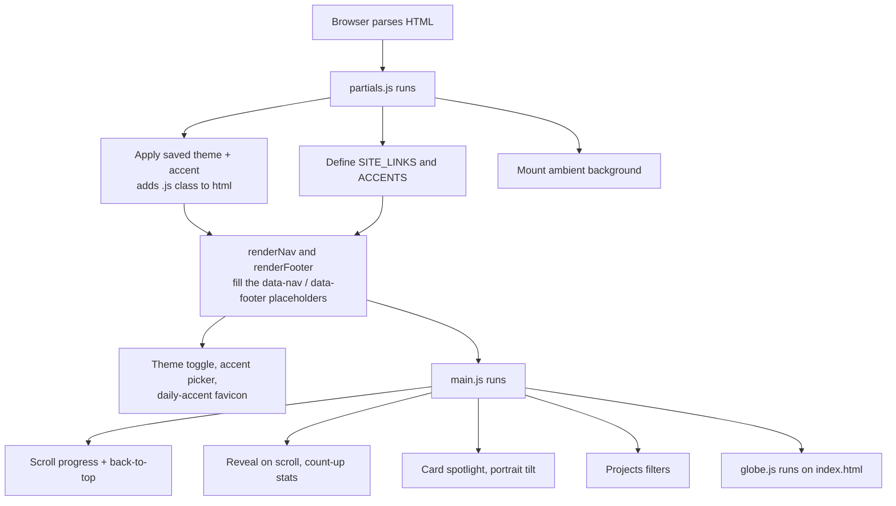

# Architecture

How the site is put together and why. Read this before adding a page,
changing the theme, or touching the deploy process. Keep it up to date when
decisions change.

## Goals

A personal portfolio for Luis de Oliveira — cybersecurity and cloud-security
work, research, and NCAA D1 swimming — for recruiters and collaborators.

1. **Professional first.** One signature "wow" (the globe), restrained motion elsewhere.
2. **Static and dependency-free.** No backend, framework, bundler or package manager.
3. **Easy to maintain.** Shared nav/footer in one place; one stylesheet; no build to break.
4. **Accessible.** Readable contrast in every theme, keyboard-friendly controls, reduced-motion respected.

## Tech stack

| Layer | Choice | Notes |
| --- | --- | --- |
| Markup | HTML5 | Hand-written, one file per page |
| Styling | CSS3, one file | Custom properties drive both themes and the daily accent |
| Behavior | Vanilla JavaScript | Three scripts, no modules, no `fetch` (works from `file://`) |
| Graphics | `<canvas>` 2D | The globe; no WebGL, no libraries |
| Hosting | Static files | Hostinger (manual upload); optional manual GitHub Pages workflow |
| CI | GitHub Actions | Lint, link check, secret scan, CodeQL |

The only external request the site makes is Google Fonts (Space Grotesk,
Space Mono). There is no analytics, cookie or tracking code.

## Repository layout

```text
.
├── index.html                  Home
├── pages/
│   ├── about.html
│   ├── experience.html
│   ├── projects.html           Has the filter chips (data-cats on each card)
│   └── contact.html
├── styles/main.css             All styles — see "Styling" below
├── js/
│   ├── partials.js             Nav, footer, theme, accent, favicon, ambient background
│   ├── main.js                 Page interactions
│   └── globe.js                Globe (index.html only); land dots embedded
├── assets/
│   ├── images/luis-portrait.jpg
│   └── icons/                  Favicon set; source/lf-monogram.png is the master
├── design/
│   └── motion-design-decisions.md   Interaction/motion decisions (source of truth)
├── docs/screenshots/           Images for the README
├── tools/
│   ├── generate-globe-data.mjs  Rebuilds the land dots (dev only)
│   └── generate-icons.py        Rebuilds the icon set (dev only)
├── .github/                    Workflows, Dependabot, templates, CODEOWNERS
├── README.md  ARCHITECTURE.md  CHANGELOG.md
├── CONTRIBUTING.md  SECURITY.md  CODE_OF_CONDUCT.md  LICENSE
└── .gitignore  .gitattributes  .editorconfig  .htmlhintrc
```

`design/`, `docs/`, `tools/`, `.github/` and the Markdown files are for
development only. They are not part of what gets deployed.

## How a page loads

Every page ends with the same three steps, in this order:

```html
<script src="js/partials.js"></script>
<script>
  renderNav('', 'index.html');   // '' at the root, '../' inside pages/
  renderFooter();
</script>
<script src="js/main.js"></script>
<!-- index.html only: --> <script src="js/globe.js"></script>
```



### `js/partials.js`

- **Early block:** reads `theme` and `accent` from `localStorage` (inside
  `try/catch`, so private mode is fine), sets `data-theme` / `data-accent` on
  `<html>`, and adds the `js` class that enables scroll-reveal styles.
- **`SITE_LINKS`** — the single definition of the nav. **`ACCENTS`** — the seven
  daily accents (index = `Date.getDay()`).
- **`renderNav()` / `renderFooter()`** — fill the `[data-nav]` / `[data-footer]` placeholders.
- **Theme toggle, accent picker, favicon** — see "Theming" below.
- **Ambient background** — three slow, blurred blobs behind the page, colored by the accent.

### `js/main.js`

Self-contained blocks, each of which does nothing if its markup isn't on the page:
Curved Loop hero text, scroll progress bar, back-to-top, scroll reveal,
count-up stats, card spotlight, portrait tilt, and the projects filters.

### `js/globe.js`

Draws the globe from a flat array of land-dot coordinates (Natural Earth 110m,
public domain, about 3,360 dots). It pauses when off-screen or when the tab is
hidden, reads colors from the CSS variables (so it follows theme and accent),
and re-reads them via a `MutationObserver` when `data-theme` / `data-accent`
change. Places are defined in the `PLACES` object at the top of the file.

## Theming

All colors are CSS custom properties on `:root` in `styles/main.css`.

- **Base palette** (`--bg`, `--surface`, `--text`, `--muted`, …) is fixed and
  warm. Dark is the default; `:root[data-theme="light"]` overrides it.
- **Accent pair** (`--accent`, `--accent2`, `--accent-hover`) is overridden by
  `:root[data-accent="mon"]` and the light-theme variant
  `:root[data-theme="light"][data-accent="mon"]`.
- **Daily accent:** `partials.js` picks `ACCENTS[new Date().getDay()]` unless
  the visitor chose one (stored as `accent`). A footer note says which is showing.
- **Favicon:** `updateFavicon()` draws the "LF" monogram on a tile in the current
  accent via `<canvas>` and swaps the `<link rel="icon">`. The static files in
  `assets/icons/` are the Brick fallback and what phones use for home-screen icons.

### Contrast rule

Every accent must reach **≥ 4.5:1** against `--bg`, `--surface` and `--bg-alt`
in *both* themes (WCAG AA for body text), and the button text color
(`--on-accent`) must reach 4.5:1 against the accent. Check new colors before adding them.

### Add or change an accent

1. Add an entry to `ACCENTS` in `js/partials.js` (key, name, day label, dark-theme accent for the picker dot).
2. Add its two CSS rules (dark + light) to the "Daily accent" block in `styles/main.css`.
3. Verify the contrast rule above.

## Styling

One stylesheet for the whole site — no CSS-in-JS and no per-page files. Sections
are labelled with comment banners in the order: variables → base → ambient
background → nav → hero → buttons → sections → components → responsive →
theme/interaction additions → daily accent → globe.

## Accessibility & motion

- `prefers-reduced-motion`: the ambient blobs, curved text, reveal animations,
  count-up, tilt, globe spin and fly-to animation are all disabled or made instant.
- Controls are real `<button>`s with `aria-label` / `aria-pressed`; the accent
  popover closes on Escape; focus rings use the accent color.
- The globe canvas has `role="img"` and a descriptive label; the information it
  shows is also in the page text. Vertical scrolling still works over it on phones.
- Pointer-only effects (spotlight, tilt) apply only on devices with a fine pointer.

## Conventions

### Shared nav and footer

Never copy nav or footer markup into a page. Edit `SITE_LINKS` or
`renderFooter()` in `js/partials.js` once.

### Adding a page

1. Add an entry to `SITE_LINKS` in `js/partials.js`.
2. Copy an existing page in `pages/` (head, `data-nav`/`data-footer` placeholders, script tags).
3. Call `renderNav('../', 'pages/your-page.html')` and `renderFooter()` in its inline script.
4. Link to it from somewhere sensible.
5. Add the `reveal`-able elements you want animated to the selector list in `initReveal()` in `main.js`.

### Adding a project to the Projects page

Copy an existing card, and set `data-cats` to a space-separated list from:
`security cloud embedded software web`.

### Repository hygiene

- Never commit secrets or credentials; `.gitignore` blocks common names and CI scans every push.
- Optimise images before committing, and strip EXIF/location data from photos.
- Use clear commit prefixes: `feat:`, `fix:`, `docs:`, `ci:`.

## Deployment

Deploys are **manual on purpose**, so unreviewed changes never go live.

- **Hostinger (current plan):** upload `index.html`, `pages/`, `styles/`, `js/`
  and `assets/` to `public_html`. Leave out `.git/`, `.github/`, `design/`,
  `docs/`, `tools/` and the `.md` files.
- **GitHub Pages (optional):** `.github/workflows/deploy.yml` runs only via
  *Actions → Deploy to GitHub Pages → Run workflow*.

### Domain

Not purchased/attached yet. When it is: attach it in hPanel (*Domains*), enable
the free SSL certificate, turn on *Force HTTPS*, upload the site, then add the
live URL to the README.

## CI and automation

| Workflow | Trigger | What it does |
| --- | --- | --- |
| `ci.yml` | push to `main`, pull requests | `node --check` on scripts, `htmlhint` on pages, internal link check (lychee, offline), Gitleaks secret scan |
| `codeql.yml` | push, PR, weekly | CodeQL analysis of the JavaScript |
| `deploy.yml` | manual only | Publishes the repo to GitHub Pages |
| Dependabot | weekly | Updates pinned GitHub Actions |

## Regenerating generated assets

- **Globe dots:** `tools/generate-globe-data.mjs` (instructions in its header)
  → paste the output over `LAND` in `js/globe.js`.
- **Icons:** `python3 tools/generate-icons.py` (needs Pillow) rebuilds the whole
  favicon set from `assets/icons/source/lf-monogram.png`.

## Known limitations and open decisions

- **Theme flash:** the saved theme is applied when `partials.js` runs at the end
  of `<body>`, so a returning light-theme visitor may see a brief dark flash. Moving a
  tiny inline script into `<head>` would fix it.
- **Hosting statement:** the site is documented as Hostinger-first, but the
  Projects page's "This Portfolio" card describes GitHub Pages — keep those consistent.
- **Projects page "creative studio" treatment** (book layout + light-beam
  background) and the ImageTrail option are not built; see
  `design/motion-design-decisions.md`.
- **Domain / hosting plan** not purchased yet.
- **Browser support:** modern evergreen browsers only (uses `color-mix()`, `aspect-ratio`).

## Design decisions

`design/motion-design-decisions.md` is the source of truth for interaction and
motion choices (nav, hero, cursor effects, the Projects-page concept). A copy is
kept in the "My Website" Claude Project; update both if one changes.
