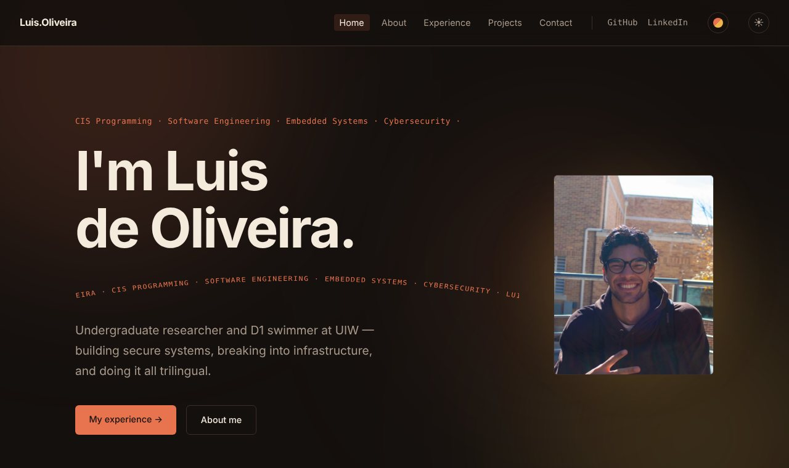
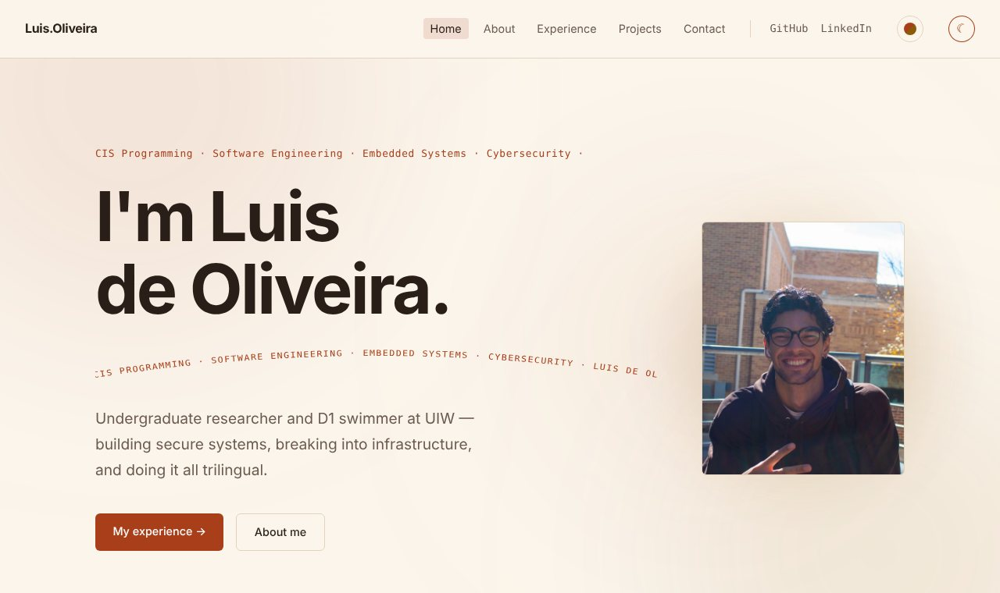
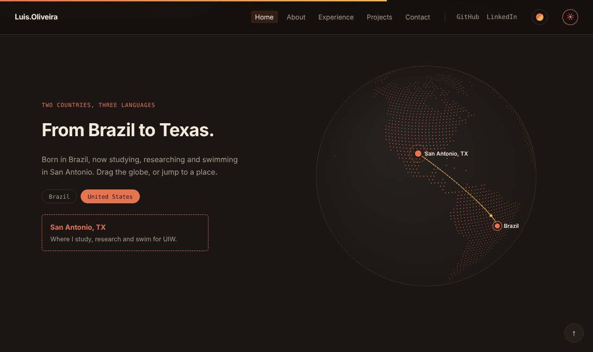

<div align="center">

# Luis de Oliveira — Portfolio

**A lightweight, dependency-free personal site: cybersecurity, cloud security, embedded systems and D1 swimming.**


</div>



> **Just for viewing.** This is my personal portfolio, shared so people can see
> my work. It isn't accepting contributions, issues or pull requests.

## Highlights

- **Two themes and a daily accent.** A warm brick-and-cream palette in dark and
  light. The accent color changes with the day of the week (seven hand-picked,
  contrast-checked pairs), and visitors can choose their own.
- **Interactive globe.** A draggable dotted globe on plain `<canvas>` — Brazil and
  San Antonio, TX — with hover/tap markers and fly-to buttons.
- **Filterable projects** by Security, Cloud, Embedded/ICS, Software and Web.
- **Quiet, purposeful motion.** Scroll reveal, count-up stats, cursor spotlight on
  cards, a hero text loop and a flowing nav — all switched off for visitors who
  prefer reduced motion.
- **Zero dependencies.** Plain HTML, CSS and JavaScript. No framework, bundler,
  package manager or build step.
- **Private by default.** No analytics, cookies or trackers.

| Light theme | Globe |
| :---: | :---: |
|  |  |

## Pages

| Page | What's there |
| --- | --- |
| **Home** | Intro, current work, the globe, skills |
| **About** | Background, quick facts, honors |
| **Experience** | Work and education timeline |
| **Projects** | Featured and personal projects, with filters |
| **Contact** | GitHub, LinkedIn and email |

## Tech stack

- **HTML5** — semantic markup, one file per page
- **CSS3** — custom properties for theming, grid/flexbox, `color-mix()`
- **Vanilla JavaScript** — shared nav/footer, theme and accent system, interactions, canvas globe
- **Hosting** — static files deployed with Cloudflare Pages

## Run it locally

Clone the repo and open `index.html` in a browser. There is no build step and no
server. A modern browser is required (Chrome/Edge 111+, Safari 16.2+, Firefox 113+).

## Project structure

```text
.
├── index.html            Home
├── pages/                about, experience, projects, contact
├── styles/main.css       All styles (themes, layout, effects)
├── js/
│   ├── partials.js       Shared nav + footer, theme, daily accent, tab icon
│   ├── main.js           Page interactions
│   └── globe.js          Canvas globe
├── assets/               images and icons
├── docs/screenshots/     Images used in this README
└── ARCHITECTURE.md       How it fits together
```

## License

- **Code** is released under the [MIT License](./LICENSE).
- **Photos and personal content** (my portrait and other images of me, my "LF"
  monogram, and the written content about me) are © 2026 Luis de Oliveira,
  **all rights reserved**, and are not covered by the MIT License. See
  [`assets/images/NOTICE.txt`](./assets/images/NOTICE.txt).
